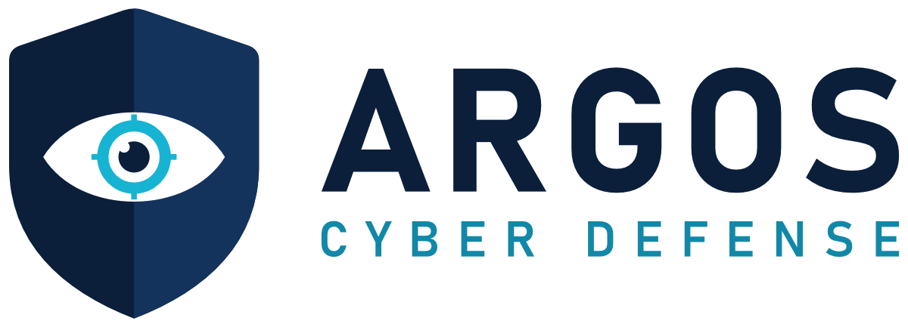

<p align="center">
  
</p>

<p align="center">
  <strong>Detectem, analitzem i prevenim les vulnerabilitats de la vostra infraestructura.</strong>
</p>

<p align="center">
  <a href="https://creativecommons.org/licenses/by-nc-sa/4.0/deed.ca"></a>
  
  
  <a href="https://argoscyberdefense.tech"></a>
</p>

---

# Argos Cyber Defense · SentinelX Audit Suite

Repositori del **projecte intermodular de 2n curs** del Cicle Formatiu de Grau Superior
d'Administració de Sistemes Informàtics en Xarxa (**ASIX**), perfil professional de
**ciberseguretat**, a l'Institut de l'Ebre (Tortosa).

Conté **SentinelX Audit Suite**, l'aplicació d'auditoria de seguretat desenvolupada per
Argos Cyber Defense (carpeta [`sentinelx/`](sentinelx/)).

La web corporativa i l'**Àrea de clients** són a **[argoscyberdefense.tech](https://argoscyberdefense.tech)**,
allotjades en un hosting amb PHP i MySQL. SentinelX hi desa els resultats de cada auditoria a
l'expedient del client perquè el client els consulti iniciant la sessió amb el seu compte.

> Argos Cyber Defense, S.L. és una empresa fictícia creada amb finalitats acadèmiques.

## Equip

| Integrant | Rol |
|-----------|-----|
| Razvan Nastasa Ghitau | Scrum Owner |
| Lluc Sarrà Masdeu | Scrum Master |
| Mouhammed Oualy | Scrum Manager |

## Descàrrega

La darrera versió empaquetada és a la pàgina de
**[Releases](https://github.com/razvan-ng/argos-cyber-defense/releases/latest)**:

- Enllaç directe: [`sentinelx-audit-suite.zip`](https://github.com/razvan-ng/argos-cyber-defense/releases/latest/download/sentinelx-audit-suite.zip)

## SentinelX Audit Suite

Aplicació d'escriptori en Python (CustomTkinter) per fer auditories de seguretat: descobriment
d'equips i serveis amb nmap, auditoria i reforçament del sistema local, correlació de
vulnerabilitats amb CVE (diccionari local, NVD API i scripts NSE), generació d'informes en
HTML, PDF, JSON i CSV, **expedients i reauditories** connectats amb la web i publicació dels
resultats a l'**Àrea de clients**. La versió actual és la **2.0.0** (vegeu el [registre de canvis](CHANGELOG.md)).

Inici ràpid a Ubuntu 24.04 / 26.04 LTS:

```bash
unzip sentinelx-audit-suite.zip
cd sentinelx-audit-suite
chmod +x install_dependencies.sh
./install_dependencies.sh
source venv/bin/activate
python main.py
```

Des del codi font, substituïu les dues primeres ordres per `git clone` i `cd argos-cyber-defense/sentinelx`.

Tota la documentació és a [`sentinelx/README.md`](sentinelx/README.md) i
[`sentinelx/QUICKSTART.md`](sentinelx/QUICKSTART.md).

> **Avís legal i ètic:** SentinelX s'ha d'utilitzar exclusivament sobre xarxes i sistemes per
> als quals es disposi d'autorització expressa i per escrit. L'ús no autoritzat sobre sistemes
> de tercers pot constituir un delicte.

## SentinelX i la web: com treballen junts

SentinelX i la web d'Argos comparteixen els **expedients** de cada client:

```
 Web (formulari)          Web (administració)            SentinelX                       Àrea de clients
 Sol·licitud d'auditoria → Empresa + expedient  →  Auditoria / reauditoria  →  Revisió i publicació  →  El client consulta
                           EXP-2026-0001            (desament automàtic)       (esborrany → publicat)    l'informe i el PDF
```

1. Un client demana una auditoria des del formulari de la web; l'administrador la converteix en
   empresa client i n'obre l'**expedient**.
2. A SentinelX, pestanya **Expedients**, l'auditor inicia la sessió amb el seu usuari
   administrador de la web i obre l'expedient. Si ja té auditories, la nova és una
   **reauditoria** i es compara amb l'anterior (vulnerabilitats resoltes, noves i pendents).
3. Mentre es treballa, els resultats es desen a l'expedient com a **esborrany**.
4. L'equip d'Argos revisa l'auditoria (validació i eliminació de falsos positius) i la publica.
5. El client inicia la sessió a l'**Àrea de clients**, consulta l'informe, la comparació amb
   l'auditoria anterior i el descarrega en PDF, CSV o JSON.

Si la web està en un allotjament que no permet la connexió de SentinelX (com l'allotjament
gratuït d'InfinityFree), l'intercanvi es fa amb fitxers: la web descarrega l'expedient per a
SentinelX i SentinelX n'exporta l'auditoria per pujar-la a la web.

La comunicació directa es fa sempre per HTTPS amb sessions que caduquen; les auditories es desen
xifrades (AES-256-GCM) i cada client només pot veure les publicades de la seva empresa.

## Estructura del repositori

```
.
├── sentinelx/                  # Codi font de l'aplicació SentinelX (Python)
├── .github/workflows/
│   └── release.yml             # Empaqueta SentinelX i crea una release a cada etiqueta vX.Y.Z
├── index.html, 404.html        # Redirecció de l'antiga adreça de GitHub Pages a argoscyberdefense.tech
├── CHANGELOG.md                # Registre de canvis de cada versió
├── LICENSE                     # Text legal de la llicència CC BY-NC-SA 4.0
└── README.md
```

## Publicar una versió nova

1. Actualitzeu el número de versió a [`sentinelx/data/branding.json`](sentinelx/data/branding.json)
   (per exemple, `2.0.1` per a una correcció o `2.1.0` per a una funcionalitat nova) i afegiu-ne
   els canvis a [`CHANGELOG.md`](CHANGELOG.md).
2. Pugeu els canvis i creeu l'etiqueta de la versió:

   ```bash
   git tag v2.0.0
   git push origin v2.0.0
   ```

3. GitHub Actions comprova que l'etiqueta coincideix amb la versió, empaqueta SentinelX i crea la
   release automàticament amb els fitxers
   `sentinelx-audit-suite-2.0.0.zip` i `sentinelx-audit-suite.zip` (el que enllaça la web).

## Llicència

<a rel="license" href="https://creativecommons.org/licenses/by-nc-sa/4.0/deed.ca"></a>

© 2026 Razvan Nastasa Ghitau, Lluc Sarrà Masdeu i Mouhammed Oualy.

Aquest repositori (aplicació SentinelX, logotips i documentació) està subjecte a una
llicència [Creative Commons Reconeixement-NoComercial-CompartirIgual 4.0 Internacional
(CC BY-NC-SA 4.0)](https://creativecommons.org/licenses/by-nc-sa/4.0/deed.ca). Podeu
compartir-lo i adaptar-lo sempre que:

- **Reconeixement (BY):** en citeu els autors i indiqueu si hi heu fet canvis.
- **NoComercial (NC):** no el feu servir amb finalitats comercials.
- **CompartirIgual (SA):** distribuïu les obres derivades amb aquesta mateixa llicència.

El text legal complet és al fitxer [`LICENSE`](LICENSE).
